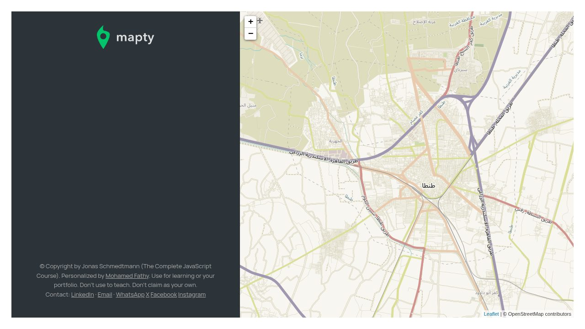

# Mapty

A workout tracker: click on the map to log a running or cycling workout, and it stays saved in the browser.

**Try it:** https://mhmd7710d.github.io/Maphty-Project/

## What you can try
1. Allow location access when the browser asks, so the map centres on you.
2. Click anywhere on the map and fill in the workout form.
3. The workout appears in the list; click it to move the map back to it.
4. Reload the page: your workouts are still there, saved in this browser only.

## Built with
HTML, CSS and vanilla JavaScript with classes, the Geolocation API, Leaflet for the map (OpenStreetMap tiles) and localStorage for saving.

## What I practised
Object-oriented JavaScript with classes and inheritance, the Geolocation API, a third-party map library, and saving and restoring data from localStorage.

## Run it locally
Download the repository and open `index.html` in a browser. Geolocation needs https or localhost, so the live link above is the easy way.

## Credits
Original project from Jonas Schmedtmann's Complete JavaScript Course, all copyright to Jonas Schmedtmann. Personalized by Mohamed Fathy.

## Contact
- LinkedIn: https://www.linkedin.com/in/muhammad-fathi-b7a693424/
- X (Twitter): https://x.com/mouahid7710
- Facebook: https://www.facebook.com/share/1CQhxpCeYL/
- Instagram: https://www.instagram.com/mhmd7710d/
- Email: muhammutfathi@gmail.com
- WhatsApp: https://wa.me/201040428475?text=Hi+Mohamed%2C+I+found+your+project+on+GitHub.
